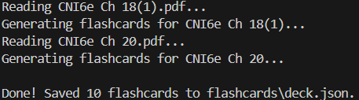
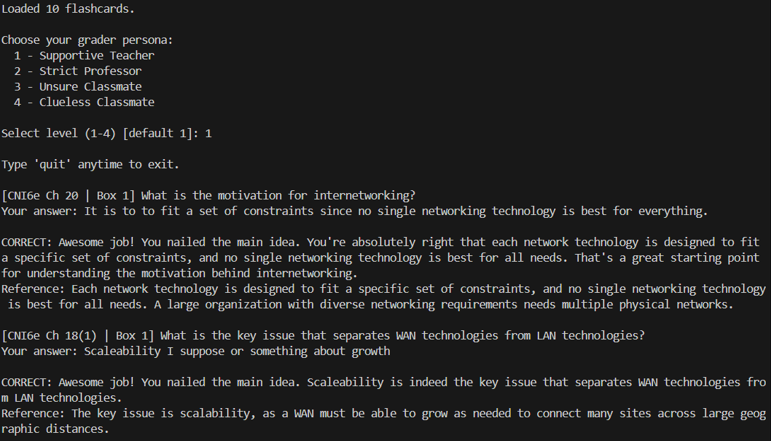

# AI Student Study Assistant

A 100% offline, privacy-first command-line study assistant powered by **Ollama (`llama3.2`)** and **Python**. Drop your lecture PDFs into `slides/`, automatically generate structured study flashcards, and quiz yourself using a **Leitner spaced-repetition system** graded by four selectable AI personas.

---

## Key Features
* **Offline PDF-to-Flashcard Pipeline:** Extracts text from lecture slide PDFs (`pypdf`) and creates concise, exam-level Q&A cards enforced via `Pydantic` structured JSON schemas.
* **Leitner Spaced Repetition:** Tracks mastery across three boxes (`Box 1` through `Box 3`). Missed cards reset to `Box 1` for higher-frequency review, while correct answers promote upward.
* **Four Selectable AI Grader Personas:**
  1. **Supportive Teacher:** A cool and Encouraging, concept-focused feedback, like a teacher who believes in you and your success
  2. **Strict Professor:** Rigorous grading that demands complete technical terminology, like a teacher who knows everything about the topic and expects the same from you 
  3. **Unsure Classmate:** Accurate grading delivered with nervous, hesitant study-buddy energy, like a shy classmate who might know what you're talking about, but lacks confidence. 
  4. **Clueless Classmate:** Randomized, comedic responses from a peer who didn't study, so a classmate who is just as clueless as you might be.
* **Real-Time Token Streaming:** Displays grading feedback word-by-word as the local model generates it, automatically saving progress to `flashcards/deck.json` after every question.

---

## Project Structure
```text
AIProjectG/
├── slides/                 # Place your PDF files here
├── flashcards/             # Auto-generated JSON flashcard decks (deck.json) created from your PDF files
├── screenshots/            # Terminal execution screenshots for documentation and display purposes
├── generate_cards.py       # Reads PDFs in slides/ and generates flashcards/deck.json
├── quiz.py                 # Interactive CLI quiz loop with persona grading and token streaming responses
├── requirements.txt        # Python dependencies
├── requirements.md         # Functional & non-functional system specifications
├── PLANNING.md             # Development milestones & architectural trade-offs
├── AI_USAGE_LOG.md         # A log of AI-assisted development
└── README.md               # standard Project overview & setup guide
```

---

## Prerequisites & Setup

1. **Install Ollama & Pull `llama3.2`:**
   Download Ollama from [ollama.com](https://ollama.com) and pull the model locally:
    *It looks cute too :)* 
   ```bash
   ollama pull llama3.2
   ```
   
2. **Clone the Repository & Install Python Dependencies:**
   ```bash
   git clone https://github.com/Alejandro-M-Astello/AIProjectG.git
   cd AIProjectG
   pip install -r requirements.txt
   ```

---

## How to Run

### Step 1: Generate Flashcards from Lecture PDFs
Place your PDF files, whether it be one or more `.pdf` lecture files inside the `slides/` folder,and then run:
```bash
python generate_cards.py
```
The script extracts text from each PDF, queries `llama3.2` using structured JSON outputs, and saves your deck to `flashcards/deck.json`.



### Step 2: Start an Interactive Quiz Session
Run the quizzer and pick your preferred grader persona (`1`–`4`) using:
```bash
python quiz.py
```
Type your answers to each prompt, review the streamed AI feedback alongside the reference answer, and type `quit` anytime to save and exit.



---

## Future Enhancements
* **User-Configurable Card Count & Multi-Chunk PDF Processing:** Prompt users to specify how many flashcards to generate per PDF (or scale dynamically by page count) and split large 70+ slide decks into overlapping page chunks so later chapters receive equal coverage without exceeding local model context windows.
* **Direct `.ppt` / `.pptx` Slide Ingestion:** Add `python-pptx` support so PowerPoint decks can be dropped into `slides/` directly without converting to PDF first.
* **Multi-Course Deck Profiles & Anki Export:** Support subject-specific JSON decks (`flashcards/networks.json`, `flashcards/os.json`) and export decks to `.apkg` format.
* **Lightweight Local Web UI:** Build an optional browser interface using HTML, CSS, and Javascript for a more professional and appealing look.